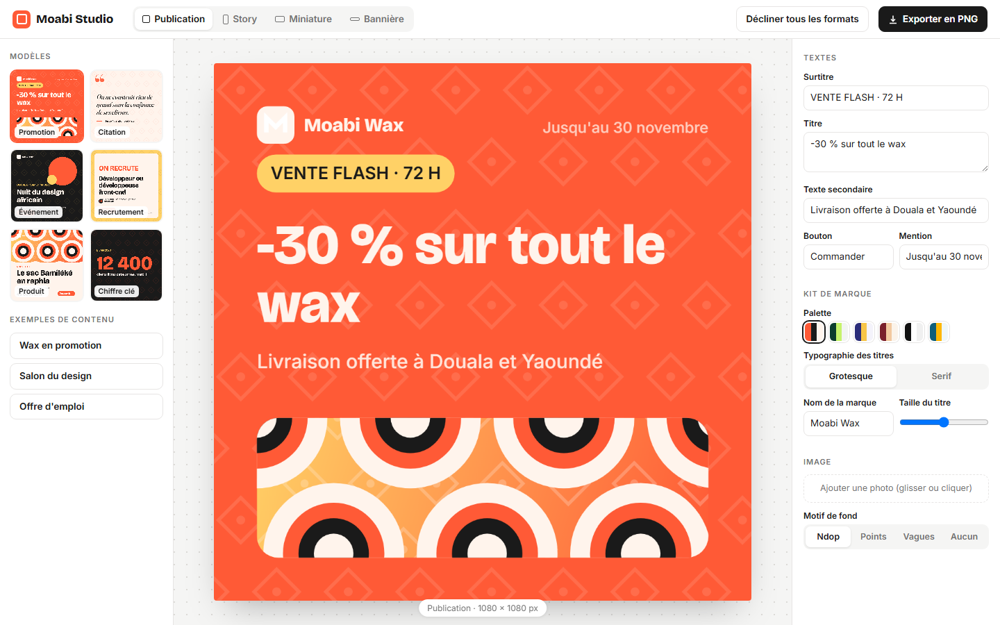
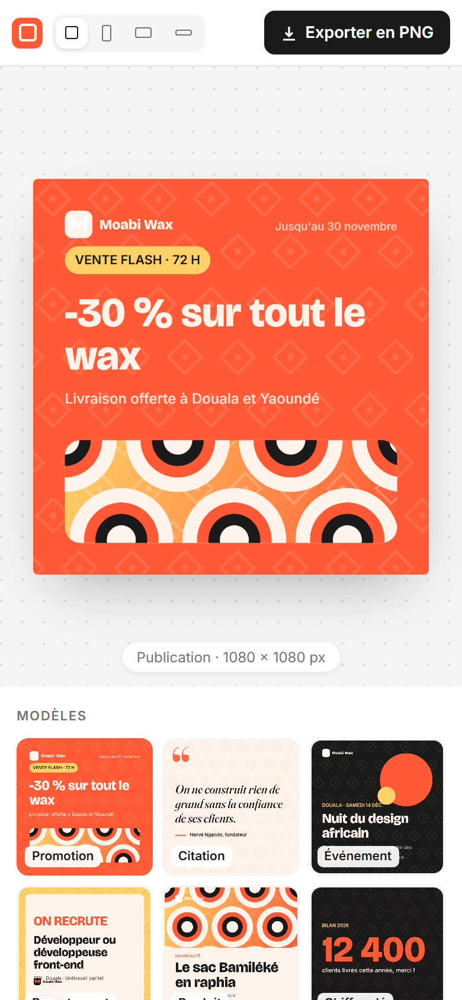

# Moabi Studio

**Générateur de visuels pour les réseaux sociaux** — Outil de création de visuels pour les réseaux sociaux d'une marque de mode : six modèles (promotion, citation, événement, recrutement, produit, chiffre clé), textes modifiables, kit de marque (palette, typographie, nom), photo personnelle par glisser-déposer et motifs inspirés du tissu ndop. Le même contenu se recompose pour quatre formats et s'exporte en PNG haute définition.

**Démo en ligne : [https://lordlennyx.github.io/moabi-studio-visuels/](https://lordlennyx.github.io/moabi-studio-visuels/)**

Spot de présentation (30 s) : [media/spot-30s.mp4](https://lordlennyx.github.io/moabi-studio-visuels/media/spot-30s.mp4)

## Ce que le projet montre

- Six modèles composés sur canvas avec ajustement automatique de la taille des titres
- Quatre formats : publication 1080 × 1080, story 1080 × 1920, miniature 1280 × 720, bannière 1584 × 396
- Kit de marque : six palettes, deux typographies, nom de marque, taille du titre
- Photo personnelle par glisser-déposer, recadrage automatique, motifs de fond
- Déclinaison de tous les formats en un clic et export PNG à la résolution native

## Réalisation

- **Stack :** HTML, CSS, JavaScript natif, Canvas 2D
- **Typographies :** Bricolage Grotesque, Fraunces, Inter
- **Évolutions possibles :** génération de textes par IA, planification de publication, carrousels multi-pages, export vidéo animé

| Bureau | Mobile |
|---|---|
|  |  |

---

Client et contenus fictifs, créés pour la démonstration. Conception, design et développement : **Njundiyimun Béchard** — [github.com/LordLennyx](https://github.com/LordLennyx)
